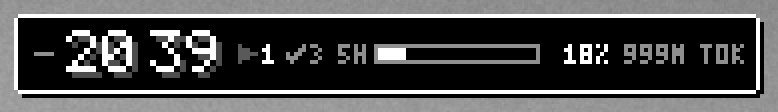
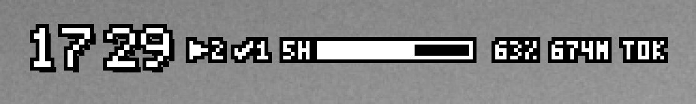
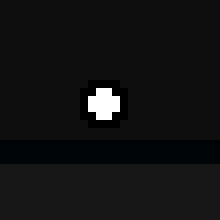

# Glance

A tiny pixel-art clock for your desktop that shows, at a glance, how your Claude Code sessions are doing: working, waiting on you, or done. It also shows your plan limits and today's tokens.

- **Session status**: `>` working, `!` waiting on you (a permission, a question, a plan to review), `v` done. A short pop-up tells you when a session needs you or finishes.
- **Plan limits**: your 5-hour and weekly usage (Pro and Max plans), with reset times.
- **Tokens**: today's total, and per session.
- **Stays out of the way**: a compact card or a flat bar, five sizes, any width you drag it to. Hide it to a single dot with **Ctrl+Alt+G**.
- **Themes**: Mono dark, Mono light, Transparent (just outlined text), Retro and Game Boy.

| Transparent theme | Hidden to a dot |
|---|---|
|  |  |

## Download

For Windows 10 and 11 (x64): get `glance.exe` from [Releases](../../releases/latest), or `Glance-vX.Y.Z-windows-x64-portable.zip` if you'd rather have the license files with it.

1. Put `glance.exe` in a folder you'll keep it in, for example `%LOCALAPPDATA%\Programs\Glance\`.
2. Run it. Windows may say "Windows protected your PC" because the app isn't code-signed; choose **More info → Run anyway**.
3. Right-click the clock → **Connect**, so Claude Code reports its sessions. Turn on **Plan limits** as well if you want them.

To update, quit Glance from its tray icon and replace `glance.exe`.

## Using it

- **Click** the clock for usage details and your sessions; **right-click** it for settings.
- **Drag** it anywhere, or **drag its right edge** to set a width.
- **–** on its left hides it to a dot. Click the dot or press **Ctrl+Alt+G** (changeable in settings) to bring it back.
- The tray icon can show, hide or quit it.

## What it changes on your computer

- **Connect** adds hooks to `~/.claude/settings.json`, after backing the file up to `settings.json.glance.bak`. Each hook runs `glance.exe hook`, which writes a small status file to `~/.glance/sessions/` and exits. **Disconnect** removes only Glance's hooks.
- **Plan limits** sets Claude Code's `statusLine` to `glance.exe statusline`, which saves your limits to `~/.glance/limits.json` and prints a short line under your prompt. With a status line set, Claude Code hides some footer hints such as "esc to interrupt". Glance never replaces a status line you already have.
  Claude Code's VS Code panel doesn't run status lines, so while Plan limits are on, Glance also asks Anthropic for your usage every 5 minutes (`api.anthropic.com/api/oauth/usage`, the same source as Claude Code's `/usage`). It signs in with Claude Code's own login from `~/.claude/.credentials.json`; the token goes only to `api.anthropic.com` and is never saved or logged.
- **Start with Windows** adds a `Glance` entry under `HKCU\Software\Microsoft\Windows\CurrentVersion\Run`.
- Tokens are counted by reading Claude Code's transcripts in `~/.claude/projects`; Glance only reads them.
- Glance's own settings live in `%APPDATA%\com.glance.desktop\`.

The only internet request Glance makes is that usage check, and only while Plan limits are on. The hooks and status line point at `glance.exe` where it was when you connected, so connect again if you move it.

### Uninstall

In Glance's settings, **Disconnect**, turn **Plan limits** off and untick **Start with Windows**. Then quit it from the tray and delete `glance.exe`, the `~/.glance` folder and `%APPDATA%\com.glance.desktop`.

## Bugs

Glance is young and may still have bugs. Plan limits are the part most likely to break: since v0.1.3 they also come from an Anthropic usage endpoint that isn't documented and can change without notice.

If something looks wrong, please [open an issue](../../issues/new) with:

- your Glance version (right-click `glance.exe` → **Properties** → **Details**),
- whether you use Claude Code in a terminal, the VS Code panel, or both,
- what you expected and what you saw (a screenshot helps),
- for plan limits, the contents of `~/.glance/limits.json`.

Never paste anything from `~/.claude/.credentials.json`: it holds your Claude login.

Ideas are welcome in [Issues](../../issues) too.

## License

Free to use; see [LICENSE](LICENSE). The source code isn't published. Glance is built with [Tauri](https://tauri.app) and other open-source software, credited in `THIRD-PARTY-NOTICES.txt`, attached to every release. Fonts: Silkscreen and DotGothic16, under the SIL Open Font License.
